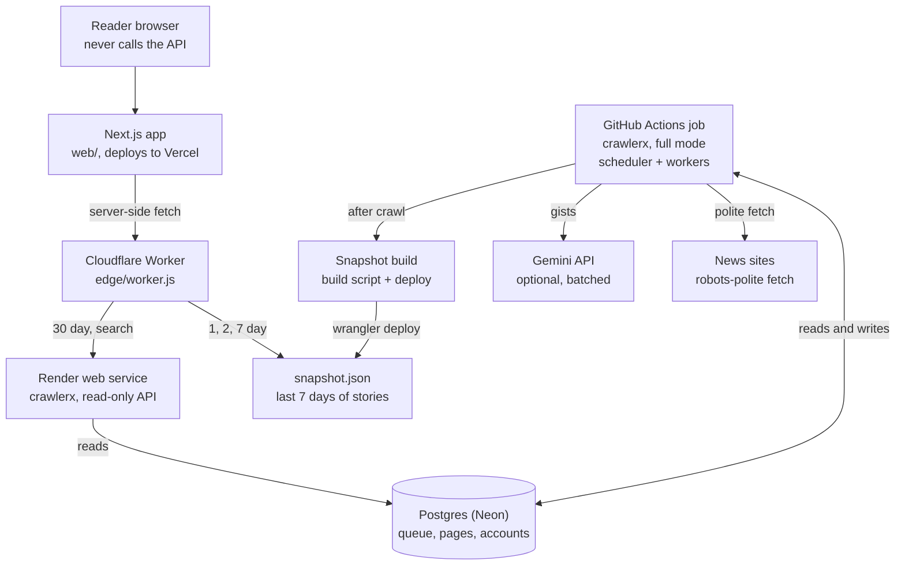

# CrawlerX Backend Onboarding: 

**What happens each day.**

1. The scheduler starts one crawl per site listed in `sources.json`.
2. Workers fetch pages politely: they obey `robots.txt`, wait between requests to the same host, and stop on a block.
3. The parser keeps only real articles (a page with its own published date, or under a source's `article_prefixes`). Listing and tag pages are dropped.
4. A summariser writes a 2-3 line gist. It uses Gemini if an API key exists, otherwise a simple extractive fallback.
5. The API serves the result as a front page, category and source filters, text search and JSON.
6. Delivery happens by email (Brevo) and a Telegram post per edition.

**The two hardest design ideas.**

- *Resumable crawling.* The crawl queue lives in a Postgres table. If the process is killed with `kill -9`, a restart continues where it stopped. Resumable crawling is the ability of a web crawler or scraper to pause or recover from a crash and continue from where it left off without losing progress or re-crawling already-visited pages
- *Three run modes from one binary.* The same Go program can be a crawler job, a read-only web server, or both. This is how the free-tier deployment works.

**Unknown so far.** Real traffic, production data size, and how much of the Pro/Teams business logic is live. The repository does not say.

## High-level architecture

Readers never touch Postgres. The Worker answers the 1, 2 and 7 day views from a snapshot built after each crawl and proxies everything else to a read-only copy of the same Go binary on Render. 

| Run mode | Where | Settings | What runs |
| --- | --- | --- | --- |
| Full | local or small server | `-sources sources.json` | API, crawl workers, daily scheduler |
| Serve-only | Render | `WORKERS=0 READ_ONLY=true`, no `SOURCES` | API only; `POST /crawls` is removed |
| Crawl job | GitHub Actions (`.github/workflows/crawl.yml`) | `crawlerx -listen=`, `SOURCES=sources.json` | scheduler and workers, no HTTP server |

## Repository structure

The Go backend is one module with four commands and about 28 packages under `internal/`. Go's `internal/` folder means any other module cannot import these packages. 

| Directory | Responsibility | Source lines | Priority |
| --- | --- | --- | --- |
| `cmd/crawlerx` | The main binary: loads config, opens the DB, wires every package, starts servers, scheduler and workers, shuts down | 335 | Critical |
| `internal/config` | Flags with environment-variable fallbacks, validation, Pro plan parsing | 465 | Critical |
| `internal/frontier` | Crawl queue and visited set in one Postgres table, claimed with `FOR UPDATE SKIP LOCKED` and leases; also an in-memory version for tests | 898 | Critical |
| `internal/crawler` | Worker loop: claim URL, robots check, politeness wait, fetch, parse, save page, enqueue links | 676 | Critical |
| `internal/scheduler` | Loads `sources.json`, starts one crawl per site at `DIGEST_AT`, runs summaries and image lookups while crawling continues | 1,152 | Critical |
| `internal/store` | `Store` interface plus Postgres and in-memory versions; digest queries, accounts, search, purge | 5,438 | Critical |
| `internal/api` | HTTP handlers (about 60 routes), auth, billing webhooks, embedded static pages | 4,312 | Critical |
| `internal/db` | pgx pool and embedded goose migrations (42 files in `internal/db/migrations`) | 75 | Important |
| `internal/summarize` | Gemini client (batched) and extractive fallback; enrichment, quiz, intro | 1,720 | Important |
| `internal/parse` | HTML to article: title, text, date, image, live-blog and 404 detection | 1,110 | Important |
| `internal/fetch`, `robots`, `politeness`, `urlnorm` | Polite-fetch parts: HTTP with retries, RFC 9309 robots, per-host delay, URL canonicalising | 284, 232, 69, 157 | Important |
| `internal/images` | `/img/{id}` proxy: looks the URL up by article id, refuses private addresses | 657 | Important |
| `internal/digestmail`, `mail`, `telegram`, `chat` | Delivery: daily email, Brevo mail sender, Telegram post, Slack/Discord webhooks | 1,181; 412; 101; 142 | Important |
| `internal/group`, `graph`, `compile`, `kind`, `sourcetype`, `track`, `prose` | Pure logic with no model call: same-event grouping, entity graph, monthly compilation, opinion/explainer label, publisher type, editions, sentence helpers | 38 to 173 each | Optional |
| `internal/testutil`, `fakesite`, `e2e` | Test support: disposable Postgres schema per test, synthetic website, subprocess tests (`kill -9`, SIGTERM) | 82; 417; 0 | Important for tests |
| `cmd/checksource`, `senddigest`, `takedown` | Operator tools: vet a site, send today's email, delete a publisher's pages | 690; 180; 69 | Optional |
| `edge/` | Cloudflare Worker (`worker.js`) that answers the 1, 2, 7 day views from a snapshot | n/a | Important |
| `web/` | Next.js 16 / React 19 front end that calls the Go API on the server | n/a | Important if you touch UI |
| `sources.json`, `catalog/` | The list of crawled sites with category, path rules; catalogue files | n/a | Important |
| `.github/workflows/crawl.yml`, `Dockerfile`, `scripts/` | Every-6-hours crawl job, distroless container build, snapshot build script | n/a | Important |
| `docs/` | Design and deploy notes; `CONCEPTS.md` explains the design | n/a | Read early |

**Observation.** Business logic sits mostly in `store` and `api`, not in a separate service layer. There is no `service` package; handlers call the `Store` interface directly. This is the biggest difference from a Spring Boot layout.

## Technology stack

The backend uses almost only the Go standard library plus five direct dependencies (`go.mod`). There is no web framework, no ORM, no Redis and no message broker.

| Area | What the repo uses | Why | Where |
| --- | --- | --- | --- |
| Language | Go 1.26 | One static binary, easy deploy to tiny free servers | `go.mod` |
| HTTP | Standard `net/http` with `http.ServeMux` method patterns such as `"GET /digest"` | No framework needed; Spring's `@GetMapping` is one line of `mux.HandleFunc` | `internal/api/api.go` (routes at lines 100-183) |
| Database | PostgreSQL (Neon in production) | The only service; stores queue, pages, accounts, quizzes | `internal/db`, `internal/store` |
| DB driver | `pgx/v5` with `pgxpool` | Fast native Postgres driver, connection pool | `internal/db`, `cmd/crawlerx/main.go` |
| Migrations | `goose/v3`, SQL files embedded in the binary, run at startup | App and schema ship together | `internal/db/migrations` (42 files) |
| Queue | A Postgres table with `FOR UPDATE SKIP LOCKED` and leases | Crash-safe and no extra service | `internal/frontier/postgres.go` |
| Search | Postgres `tsvector` + GIN index | No search server | `internal/store/postgres.go` |
| Robots rules | `temoto/robotstxt` | Parses robots.txt; the polite rules are the repo's own code | `internal/robots` |
| HTML parsing | `golang.org/x/net` | Reads article pages | `internal/parse` |
| Concurrency helper | `golang.org/x/sync` | Used in the image proxy | `internal/images/proxy.go` |
| Summaries | Google Gemini (batched) or extractive fallback | Cheap daily gists; works with no key | `internal/summarize` |
| Auth | Email + password (PBKDF2-SHA256, 600,000 iterations), recovery codes, optional Google sign-in, separate admin login | Accounts for Pro and synced notes | `internal/api/password.go`, `account*.go`, `google.go`, `admin.go` |
| Payments | Razorpay webhook | Pro plans | `internal/api/billing.go` |
| Email | Brevo (provider chosen by config) | Double opt-in and daily edition | `internal/mail`, `internal/digestmail` |
| Chat posts | Telegram Bot API, Slack and Discord webhooks | Edition delivery to channels | `internal/telegram`, `internal/chat` |
| Logging | `log/slog`, text or JSON | Standard library structured logs | `cmd/crawlerx/main.go` (`newLogger`) |
| Profiling | `net/http/pprof` on a separate address | Find memory and CPU problems | `cmd/crawlerx/main.go` (`pprofHandler`) |
| Tests | Standard `testing`, `-race`, real Postgres via `TEST_DATABASE_URL`, a fuzz test for `urlnorm` | No mock library in `go.mod` | `internal/**/_test.go`, `Makefile` |
| Edge | Cloudflare Worker (`edge/worker.js`), tested with `node --test` | Serves snapshot without waking the origin | `edge/` |
| Front end | Next.js 16.4, React 19.3, deployed to Vercel | Server-rendered pages calling the Go API | `web/` |
| Hosting | Render (web), Neon (DB), GitHub Actions (cron every 6 hours), Cloudflare, Vercel | All on free plans | `docs/DEPLOYMENT.md`, `.github/workflows/crawl.yml` |
| Container | Multi-stage `Dockerfile`, distroless non-root image | Small, no shell | `Dockerfile` |

**Not present (verified by absence in `go.mod` and imports):** Redis or any cache server, Kafka or any queue broker, an ORM, a Go web framework, a mocking library, OpenTelemetry or Prometheus metrics. Observability is logs, `pprof` and `GET /healthz`.

**Doc mismatch.** `README.md` says "40+" sources and its diagram says 43; `sources.json` has 57 entries and `crawl.yml` also says 57. Treat the README number as stale.

## The 20% to learn first

Ten modules explain most of the product. Ranked by learning order.

| # | Module | Business importance | Complexity | Contribution relevance | Why first |
| --- | --- | --- | --- | --- | --- |
| 1 | `cmd/crawlerx/main.go` | High | Low | High | 335 lines; shows how every package is wired and how shutdown works |
| 2 | `internal/config` | Medium | Low | High | Every behaviour switch (modes, limits, keys) starts here |
| 3 | `internal/store/store.go` | High | Medium | High | The `Store` interface is the contract between handlers and data |
| 4 | `internal/api/api.go` | High | Medium | High | Routes, `Deps`, `digest` handler, error helpers |
| 5 | `internal/frontier` | High | High | Medium | The resumable queue: leases, `SKIP LOCKED`, crash recovery |
| 6 | `internal/crawler/crawler.go` | High | High | Medium | The per-URL pipeline and every outcome status |
| 7 | `internal/scheduler/scheduler.go` | High | High | High | The daily job: crawls, enrichment, quiz, intro, compilation |
| 8 | `internal/store/postgres.go` and `memory.go` | High | High | High | Every filter is written twice (SQL and Go); both must agree |
| 9 | `internal/api/account*.go`, `password.go`, `billing.go` | Medium | Medium | High | Auth, Pro membership, webhooks; most likely feature work |
| 10 | `internal/summarize` | Medium | Medium | Medium | Gemini batching, quota, fallback; hard to debug when it misbehaves |

Skip at first: `internal/parse` details, `images`, `graph`, `group`, `compile`, `kind`, `sourcetype`, `telegram`, `chat`, and the 42 migrations (read `00001_init.sql` and the latest few only).

**Rule that explains the design:** `store.Postgres` and `store.Memory` must behave the same. Every filter in `DigestQuery` exists as SQL in `postgres.go` and as Go in `memory.go`, and both are tested (`CLAUDE.md`). The edge Worker repeats the same filtering a third time in JavaScript (`edge/worker.js`). A change to `/digest` filtering touches all three.

## Critical business workflows

Ranked by business importance. Chains use real function names; steps marked *inferred* were not read line by line yet.

**1. Daily digest run (the product's engine).** Verified in `internal/scheduler/scheduler.go`.

`GitHub cron or Scheduler.Run → runIfClaimed → Claims.Claim (one run per day, row in job_runs) → runOnce → Source.Specs → frontier.StartCrawlSpec (one crawl per source) → waitForCrawls (enrich fires whenever a full batch is waiting) → final enrich passes → groupStories → enrichArticles → explainConcepts → makeQuizzes → makeIntros → compileMonth → log "digest run complete"`

The model work shares one time budget (`LLMBudget`) and one request cap (`quota`). When either runs out, what is left waits for the next run instead of failing it.

**2. Crawling one URL.** Verified in `internal/crawler/crawler.go` (`process`, line 298).

`Crawler.Run → worker → handle → process → crawl lookup → attempts check (Dead) → enterHost (per-host in-flight cap) → Robots.Check (Blocked, or transient retry) → Gate.Acquire (wait: reschedule, do not sleep) → Fetcher.Fetch → by status: 304 Done, 2xx handlePage → Parser.Parse → savePage, 3xx handleRedirect, 429/5xx transient retry with Retry-After, other Failed`

The worker never sleeps on a busy host. It hands the URL back to the queue with a later due time and serves another host. That is why 16 workers stay busy while each site is still treated gently.

**3. Reading the front page.** `GET /digest` is verified in `internal/api/api.go` (line 472).

`Reader → Next.js server (web/lib/api.ts, API_BASE_URL) → Cloudflare Worker → [1, 2, 7 day: snapshot.json] or [Render: s.digest → digestQuery → pageParams → Store.Digest → add image URL, SourceType, Kind → JSON]`

If the database call fails, the handler logs the error and returns a generic 500. It does not leak the error text.

**4. Email subscription (double opt-in).** *Partly inferred.* Routes `POST /subscribe`, `/confirm`, `/unsubscribe`, `/subscription*` in `internal/api/subscribe.go` and `subscription.go`; mail through `internal/mail`; daily send by `cmd/senddigest` and `internal/digestmail` (at most once per subscriber per day, as its package comment states).

**5. Accounts and Pro membership.** *Partly inferred.* `POST /account/signup`, `/account/login`, `/account/google`, password reset and recovery codes in `internal/api/account*.go`; password hashing in `password.go` (PBKDF2, two hashes at a time via the `hashSlots` channel); Razorpay payment webhook `POST /billing/razorpay` in `billing.go`; Pro notes and synced bookmarks in `pro_notes.go`, `account_sync.go`.

**6. Snapshot publish.** Verified in `.github/workflows/crawl.yml`: build, crawl, **check the run** (fails if the model rejected the key or fewer than 20 new articles appeared), prune old rows, `go run ./cmd/takedown`, test the Worker, publish the snapshot. A failed check skips prune, snapshot and mail, so the last good snapshot stays live.

**7. Delivery to channels.** *Inferred from package names:* Telegram post per edition (`internal/telegram`), Slack or Discord team webhooks (`POST /teams`, `internal/chat`).

**8. Admin.** `POST /admin/login`, content, subscribers and Pro grants under `/admin/*` in `internal/api/admin*.go`. Registered only when admin sign-in is configured (the `adminEnabled(deps)` check in `api.go`).

## Recommended code reading order

Read in this order. Each step should take 30 to 90 minutes.

1. `CLAUDE.md`, then `docs/CONCEPTS.md`. The project's own map of design decisions.
2. `cmd/crawlerx/main.go`. Wiring, startup order and shutdown order (workers drain, then pending page writes flush, then servers stop).
3. `internal/config`. The flags and environment variables that choose a run mode.
4. `internal/api/api.go`: `Deps`, `NewHandler`, route list, then the `digest` handler and `digestQuery`.
5. `internal/store/store.go`: the interface and the `DigestQuery` struct. Then one filter in both `postgres.go` and `memory.go`.
6. `internal/db/migrations/00001_init.sql` (tables `crawls`, `frontier`, `pages`), then `00002_digest.sql` and `00008_category.sql`.
7. `internal/frontier/frontier.go` (interface, statuses), then `postgres.go` (`Claim`).
8. `internal/crawler/crawler.go`: `Run`, `worker`, `process`, `savePage`.
9. `internal/scheduler/sources.go` and `scheduler.go` (`runOnce`).
10. `internal/api/password.go`, `account.go`: first real feature work.

Tests to read beside each step: `internal/api/api_test.go`, `internal/store/memory_test.go`, `internal/frontier/frontier_test.go`, `internal/crawler/crawler_test.go`, `internal/crawler/deadlock_test.go`, `internal/e2e` (kill -9 and resume).

## Go concepts to learn first

Every example below is in code already read. Learn them in this order.

| # | Concept | Plain meaning | Real example | Spring Boot equivalent | Common beginner mistake |
| --- | --- | --- | --- | --- | --- |
| 1 | Packages and `internal/` | A folder is a package; `internal/` blocks outside imports | `github.com/wanderingtilldeath/news-aggregator/internal/store` | Java package, but visibility is by capital letter, not `public` | Lower-case names are private to the package |
| 2 | Structs and methods | Data type plus functions attached to it | `func (c *Crawler) process(...)` | A class with methods | `*Crawler` (pointer) vs `Crawler` (copy): use a pointer when the method changes state or the struct is large |
| 3 | Explicit errors | Functions return `(value, error)`; you check `if err != nil` | `main.go`: `pool, err := db.Open(...)` then `return err` | Exceptions | Ignoring the error with `_ =`; wrap with `fmt.Errorf("...: %w", err)` to keep the cause |
| 4 | Interfaces (implicit) | A type satisfies an interface just by having the methods | `store.Store` (Postgres and Memory), `frontier.Frontier` | Java interface, but no `implements` keyword | Defining the interface next to the implementation instead of where it is used |
| 5 | Dependency injection by hand | Pass dependencies into a constructor struct | `crawler.New(cfg, crawler.Deps{Frontier: front, Fetcher: ..., Robots: ...})` in `main.go` | `@Autowired` / constructor injection | Hidden globals; here `Deps` makes tests easy because any field can be a fake |
| 6 | `defer` | Run this when the function returns | `defer pool.Close()`, `defer c.leaveHost(it.Host)` | `finally` / try-with-resources | `defer` inside a loop runs at function end, not each loop pass |
| 7 | `context.Context` | A value carrying cancellation and deadlines, passed as the first argument | `signal.NotifyContext(...)` in `main`; `context.WithTimeout(ctx, s.cfg.LLMBudget)` in `runOnce` | Request scope plus `Future.cancel`, no direct equal | Not passing `ctx` down, so a shutdown cannot stop the work |
| 8 | Goroutines | Cheap concurrent function started with `go` | `go sched.Run(ctx)`; each crawler `worker` | A thread, but thousands are fine | Starting one with no way to stop it (a leak); always tie it to a `ctx` |
| 9 | Channels and `select` | A pipe between goroutines; `select` waits on several | `exitWhenDone`: `select { case <-ctx.Done(): ... case <-ticker.C: ... }` | `BlockingQueue`, `CompletableFuture` | Sending on a channel nobody reads blocks forever |
| 10 | Channel as a semaphore | Buffered channel limits parallelism | `hashSlots = make(chan struct{}, 2)` in `password.go`: only 2 password hashes at once | `Semaphore` | Forgetting to release the slot |
| 11 | Slices, maps, `append` | Growable array and hash map | `ids = append(ids, crawl.ID)` in `runOnce` | `ArrayList`, `HashMap` | Maps are not safe for concurrent writes; use a mutex |
| 12 | `go:embed` | Compile files into the binary | migrations and `internal/api/static` | Resources on the classpath | Embedded files change only when you rebuild |
| 13 | Table-driven tests and `-race` | One test function loops over cases; the race detector finds unsynchronised access | `make test` runs with `-race` | JUnit parameterised tests | Skipping `-race`; data races hide until production |

**Dependency injection without annotations.** There is no container. `main.go` builds each object once, in order (config, pool, frontier, store, crawler, scheduler, API) and hands them to the next constructor. If something is `nil`, the feature is off: `Deps.Images != nil` gates `/img/{id}`, `TeamPoster != nil` gates `/teams`. Learn to read `NewHandler` as "what is switched on".

## 14-day learning plan

About 2 to 3 hours a day. Each day ends with one exercise you do yourself before asking for the answer. Setup commands come from `CLAUDE.md`.

| Day | Focus | Read | Do |
| --- | --- | --- | --- |
| 1 | Product and modes | `README.md`, `CLAUDE.md`, `docs/CONCEPTS.md` | Draw the three run modes from memory |
| 2 | Go tour, part 1 | Concepts 1 to 6 above | Run `go build ./...` and `go test -short -race ./...`; no database needed |
| 3 | Startup | `cmd/crawlerx/main.go`, `internal/config` | Run with a local Postgres (`DATABASE_URL`), open `GET /healthz` |
| 4 | Data model | Migrations 1, 2, 8; `store/store.go` | Open the tables in `psql`; find the `category` column's history |
| 5 | First request trace | `api.go` `digest`, `digestQuery`, `Store.Digest` | Call `/digest?days=7&category=tech`; find where `category` is applied in SQL and in `memory.go` |
| 6 | Tests as documentation | `api_test.go`, `memory_test.go`, `postgres_test.go` | Run one test with `TEST_DATABASE_URL`; break a filter and watch it fail |
| 7 | Review and quiz | Your notes | Explain a `/digest` request end to end, out loud |
| 8 | The queue | `frontier/frontier.go`, `postgres.go` | Find `Claim`; explain `SKIP LOCKED` and why leases exist |
| 9 | The crawler | `crawler.go` `process`, `savePage` | Run `go run ./cmd/checksource <site>`; set a breakpoint in `process` with Delve |
| 10 | Crash recovery | `internal/e2e`, `deadlock_test.go` | Read the `kill -9` test. Note that `TestSIGTERMReleasesLeasesAndExitsCleanly` already fails on a clean checkout (`CLAUDE.md`) |
| 11 | The daily job | `scheduler.go` `runOnce`, `quota.go`, `sources.go` | Run with `-sources sources.json -run-on-start` against a disposable DB and a short source list |
| 12 | Summaries | `internal/summarize` | Run with no Gemini key and compare extractive output to a stored gist |
| 13 | Auth feature | `password.go`, `account.go`, `account_test.go` | Trace `POST /account/login` and list every failure path |
| 14 | First contribution | `FEATURES.md`, `git log`, a small test gap | Add one table-driven test; run `make lint` and `make test`; write the PR description |

**Safety rules for this repo.** `TEST_DATABASE_URL` must be a disposable local Postgres: tests create and drop schemas. Never run the crawler against production `DATABASE_URL`. Use a direct Neon connection string without `-pooler`. Do not reword the log line `digest run complete`: the crawl workflow greps for it.

**Open questions for you to settle next.** Which area do you want first: the crawl pipeline, the API and accounts, or the store and SQL? Do you work on the Go backend only, or also on `web/` (this branch is `feat/ui-redesign`)?
