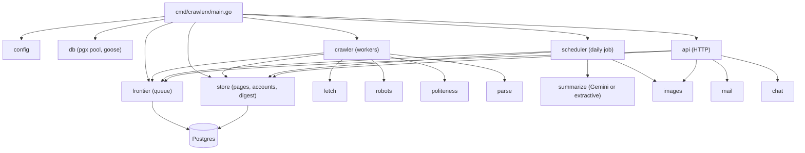
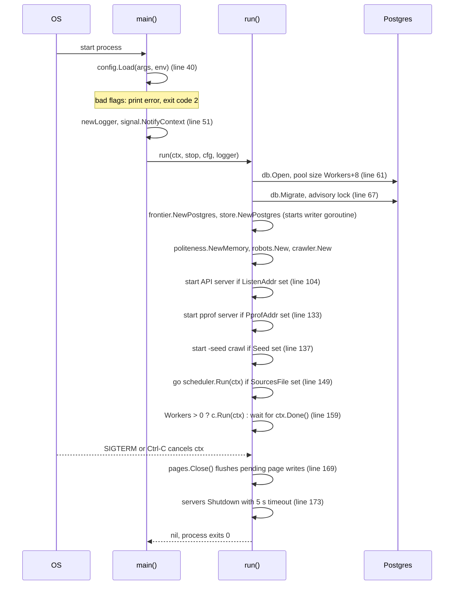
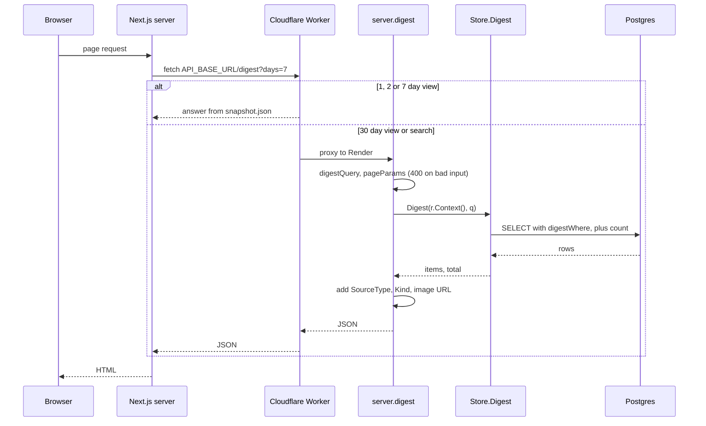
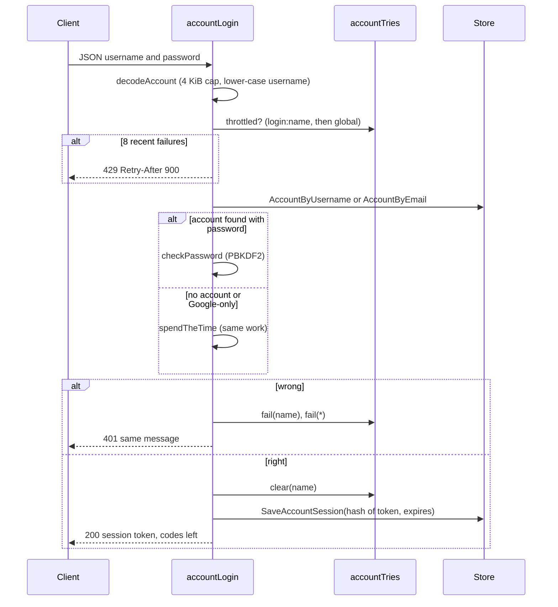
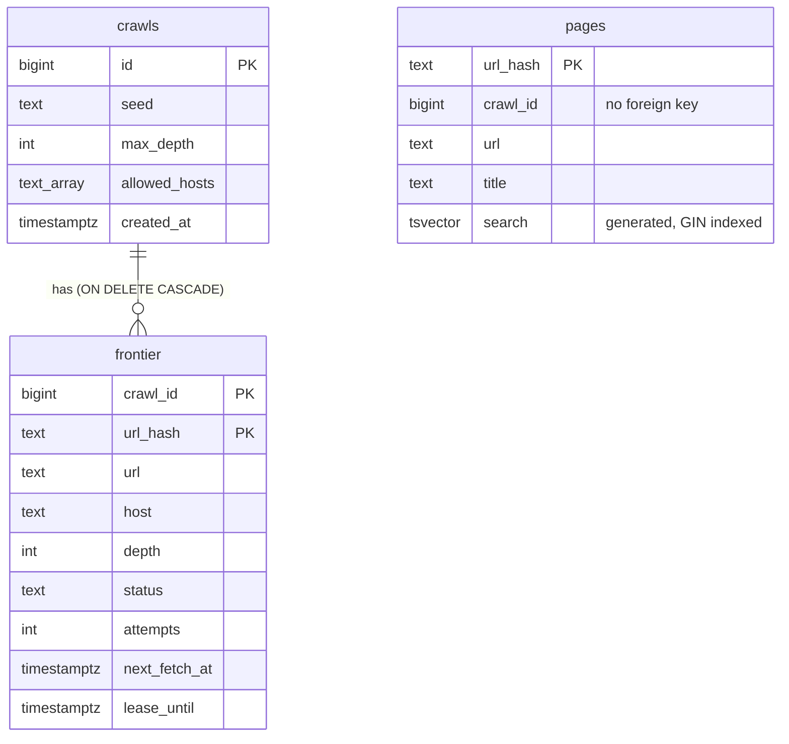

# CrawlerX Backend Onboarding: Phase 2 Onward

Continues `docs/ONBOARDING_PHASE1.md`, which this file does not repeat or change. Written 2026-11-22 on branch `feat/ui-redesign`.

**How to read this file.** Every claim is tagged where it matters:

- **Verified**: read in the code while writing this file. File and line numbers are given.
- **Inferred**: deduced from names or structure, not read line by line.
- **Needs verification**: a risk or suspicion. It is never presented as a confirmed bug.

Line numbers move when code changes. Search for the function name if a line is off.

**Sections map to your requested knowledge-base documents.** You asked for one file, so these are sections, not separate files:

| Requested document | Sections here |
| --- | --- |
| ARCHITECTURE.md | Phase 2, Phase 8 (data) |
| WORKFLOWS.md | Phase 4, Phase 5 |
| GO_LEARNING.md | Phase 3 |
| ENGINEERING_NOTES.md | Phase 6, 7, 9, 10 |
| CONTRIBUTION_GUIDE.md | Phase 11, 12, 14 |

---

## Phase 2: Architecture deep dive

### 2.1 Layers as they really exist

This repo does not have the Spring-style Controller, Service, Repository stack. The real layers are:

| Layer | Package | What it does | Spring Boot comparison |
| --- | --- | --- | --- |
| Wiring | `cmd/crawlerx/main.go` | Builds every object once and connects them | `@SpringBootApplication` plus configuration classes |
| HTTP | `internal/api` | Routes, request parsing, auth checks, JSON responses | `@RestController` classes, with no filter chain |
| Business rules | split across `internal/api` (validation, auth), `internal/store` (filters, queries), `internal/scheduler` (daily job), `internal/crawler` (per-URL pipeline) | There is no `service` package | `@Service` classes, but spread out |
| Data access | `internal/store`, `internal/frontier` | SQL through `pgx`, one interface each, plus in-memory twins for tests | `@Repository` with Spring Data, but hand-written SQL |
| Infrastructure | `fetch`, `robots`, `politeness`, `images`, `mail`, `summarize`, `telegram`, `chat` | Talk to the outside world | Clients and adapters |

**Verified:** `NewHandler` ends with `return mux` (`internal/api/api.go`, around line 187). The `ServeMux` is returned bare. There is no middleware chain (no access log, no request id, no recover wrapper). Auth is checked inside each handler with helpers such as `accountFrom` (`account.go:309`) and `principal` (`admin.go:142`).

### 2.2 Package dependency map

Built from the imports and wiring in `cmd/crawlerx/main.go`. Arrows mean "is passed to" or "uses".



Two things to notice:

1. `api` depends on `store` and `frontier` through interfaces (`store.Store`, `frontier.Frontier`). It never sees `pgx`.
2. `crawler` and `scheduler` do not call each other. They meet only through the database: the scheduler creates crawls in `frontier`, workers drain them, the scheduler polls `waitForCrawls`.

### 2.3 Startup sequence

**Verified** in `cmd/crawlerx/main.go`.



Step-by-step notes:

1. **Config.** `config.Load(os.Args[1:], os.Getenv, os.Stderr)` takes the args, the environment lookup function and an output stream as parameters. That makes it testable without touching real environment variables. Every flag has an environment fallback (`internal/config/config.go`, lines 153 to 221).
2. **Failure at startup.** Any error from `run` is logged and the process exits with code 1 (`main.go:54`). A config error exits with 2.
3. **Pool size** is `Workers + 8` so every worker can hold a connection while the API and scheduler still get some.
4. **Migrations run on every start**, including the read-only Render box. goose uses a Postgres advisory lock, so two processes starting together do not race (`internal/db/db.go`).
5. **Shutdown order** (comment at `main.go:165`): workers drain, pending page writes flush, servers stop. The HTTP servers therefore keep answering during the drain.

**Needs verification (startup/shutdown):** `go sched.Run(ctx)` at `main.go:154` is never waited for. After `c.Run` returns and `pages.Close()` runs, the deferred `pool.Close()` can run while the scheduler goroutine is still finishing a database call. In crawl-job mode this is probably harmless because the workflow waits for `digest run complete` first. Check by reading how `Scheduler.Run` reacts to `ctx.Done()`. Also note `CLAUDE.md` says `TestSIGTERMReleasesLeasesAndExitsCleanly` already fails on a clean checkout. A shutdown-order problem is one hypothesis worth testing; it is only a hypothesis.

### 2.4 Patterns actually used

| Pattern | Where | Problem it solves | Trade-off | Spring comparison |
| --- | --- | --- | --- | --- |
| Hand-written dependency injection with a `Deps` struct | `crawler.New(cfg, crawler.Deps{...})`, `api.NewHandler(api.Deps{...})`, `scheduler.New` | Tests can swap any field for a fake; no container | Long wiring code; `main.go` is the only place you see the whole graph | Constructor injection without annotations |
| Interface per boundary with a Memory twin | `store.Store` (Postgres, Memory), `frontier.Frontier`, `fetch.Fetcher`, `politeness.Gate`, `robots.Checker` | Fast unit tests with no database | Two implementations must stay identical; a lot of duplicated filtering code | Mockito, but here the fake is real code |
| Nil means off | `Deps.Images != nil` gates `/img/{id}`, `TeamPoster != nil` gates `/teams` (`api.go:117`, `168`) | Optional features without flags in every handler | Easy to forget which Deps field switches what | `@ConditionalOnProperty` |
| Strategy | `summarize.Summarizer` is Gemini or `Extractive`, chosen in `newScheduler` (`main.go:208-219`) | Works with no API key | Several interfaces (Enricher, Quizzer, Introducer, Explainer) that Gemini all implements | Strategy bean selected by profile |
| Adapter via functions | `mail.ConfirmationNotifier(...)`, `mail.ManageLinkNotifier(...)` (`main.go:113`) | Handlers call a small function type, not a mail client | Function types hide what is behind them | Event listener |
| Group commit (batched writer) | `store.Postgres.run` and `flush` (`internal/store/postgres.go:111-170`) | Many workers save pages with fewer round trips | One writer goroutine is a single point of delay; see Phase 3 | Batch insert in `JdbcTemplate`, but here callers still wait for their own result |
| Lease-based work queue | `frontier` claim SQL (`internal/frontier/postgres.go:172`) | Crash recovery with no broker | Polling, not push | A job table with `SELECT ... FOR UPDATE SKIP LOCKED`, like Quartz clustering |

### 2.5 Main design decisions and what they cost

| Decision | Why | Cost |
| --- | --- | --- |
| Postgres is the only service (queue, search, sessions) | Free-tier deployment; one thing to run | The database is the bottleneck and the 500 MB Neon limit shapes retention (`DB_LIMIT_MB`, `PAGE_RETENTION_DAYS`) |
| One binary, three modes | Render stays small (`GOMEMLIMIT=180MiB`), GitHub Actions does the heavy crawl | Behaviour depends on config combinations you must know |
| In-process politeness gate (`politeness.Memory`) | Simple | Per-host delay is only enforced inside one process (comment at `main.go:76`). Two crawlers would each respect the delay separately |
| Snapshot at the edge | Readers never wake the origin | Filtering logic exists three times: SQL, Go in-memory and JS in `edge/worker.js` |
| Redirects are enqueued, not followed (`internal/fetch/fetch.go` header comment) | robots, politeness, scope and depth apply to every hop | Redirect targets take an extra queue round trip |

---

## Phase 3: Go through this codebase

Only concepts that appear in the code. Phase 1 has the first table of concepts; this phase goes deeper with real code. File and line are given for each.

### 3.1 Struct, interface, constructor: `store.Postgres`

`internal/store/postgres.go:75`:

```go
func NewPostgres(pool *pgxpool.Pool) *Postgres {
    s := &Postgres{pool: pool, batchSize: defaultBatchSize, linger: defaultLinger,
        reqs: make(chan saveRequest), quit: make(chan struct{})}
    s.wg.Add(1)
    go s.run()
    return s
}
```

- `NewPostgres` is a plain function, not a keyword. Go has no constructors; by convention a function named `New...` returns a ready object.
- `&Postgres{...}` creates the struct and returns a **pointer** to it. Methods like `func (s *Postgres) Save(...)` use a pointer receiver so every caller shares one object, one channel and one writer goroutine.
- The constructor starts a background goroutine (`go s.run()`). That is why `main.go` must call `pages.Close()` before exit.
- At the bottom of the file: `var _ Store = (*Postgres)(nil)` (line 1857). This line holds nothing. It makes the compiler fail the build if `Postgres` stops satisfying `Store`. Go interfaces are implicit, so this is how teams get Java's "implements" safety back.

Common mistake: returning a struct by value from `New...` and then calling a pointer method on a copy. The mutex or channel inside the copy is not the original.

### 3.2 Channels, `select` and goroutines: the batched writer

`Save` (lines 92 to 109) and `run` (lines 111 to 140):

1. `Save` creates a `saveRequest` with a `done` channel that holds one error (`make(chan error, 1)`).
2. It sends the request to the writer through `s.reqs`. A `select` lets it give up if `ctx` is cancelled or the store is closing.
3. The writer goroutine collects up to `batchSize` requests or waits `linger`, then calls `flush`.
4. `flush` sends one `pgx.Batch`, then answers each caller on its own `done` channel.
5. `Save` waits on `req.done` (or `ctx.Done()`), so **from the caller's view Save is synchronous**. A worker only calls `Finish(Done)` after its page row is committed. This answers an important question: a crash cannot leave a frontier row marked done with no page saved.

Why `done` has capacity 1: the writer must never block if the caller already left because of a cancelled context. A send to a buffered channel with room returns at once.

Java comparison: this is a `BlockingQueue` plus one consumer thread plus a `CompletableFuture` per item.

Subtle detail in `flush` (lines 142 to 175): the batch runs in one implicit transaction, so one bad row would fail good rows. The code then retries rows one by one. This is why `upsertSQL` must be idempotent. `flush` also uses `context.WithTimeout(context.Background(), 30*time.Second)` and not the caller's context, so one caller giving up cannot cancel the other callers' writes.

### 3.3 `context.Context`: cancellation in three different jobs

| Where | Code | What it does |
| --- | --- | --- |
| `main.go:51` | `signal.NotifyContext(context.Background(), os.Interrupt, syscall.SIGTERM)` | A context that is cancelled when the OS sends a stop signal |
| `crawler.go:204` | `context.WithCancel(context.WithoutCancel(ctx))` | A second context for in-flight work that does **not** die when `ctx` dies. Cancelling `ctx` stops workers from claiming new URLs, while current fetches finish |
| `crawler.go:225-233` | `time.NewTimer(c.cfg.ShutdownGrace)` then `procCancel()` | After the grace period (default 15 s), cancel in-flight work too |
| `scheduler.go:248` | `context.WithTimeout(ctx, s.cfg.LLMBudget)` | A time budget for all model calls in one run |
| `api.go:534` (`healthz`) | `context.WithTimeout(r.Context(), 2*time.Second)` | A health check can never hang longer than 2 s |

Rule to remember: pass `ctx` as the first argument and hand it to every call that can block (database, HTTP, sleep). A function that ignores `ctx` cannot be stopped.

### 3.4 Errors: why Go returns them

Go has no exceptions. A function that can fail returns `(result, error)` and the caller must decide. In this repo:

- `process` (`crawler.go:298`) returns an `error` that means "this URL was **not** moved out of the leased state". `handle` (line 279) reads it and releases the lease. The meaning of the error is a protocol: nil means the row is finished or rescheduled.
- Errors are wrapped with `%w` so callers can test with `errors.Is`: `fmt.Errorf("frontier: claim: %w", err)` (`frontier/postgres.go:194`), `errors.Is(err, robots.ErrUnavailable)` (`crawler.go:323`).
- Errors shown to users are generic: `writeError(w, 500, "digest failed")` while the real error goes to `s.Logger.Error` (`api.go:488-489`). This prevents leaking SQL text.

### 3.5 Mutexes and shared state

- `attempts` (`admin.go:88`) is a `map[string][]time.Time` guarded by `sync.Mutex`. Every method starts with `a.mu.Lock(); defer a.mu.Unlock()`. A Go map is not safe for concurrent writes; without the mutex the race detector (`-race`) would flag it.
- `politeness.Memory` (`politeness.go:27`) uses the same pattern for its `next` map of host slots.
- `hashSlots` (`password.go`) is a buffered channel used as a semaphore: `make(chan struct{}, 2)` lets only two password hashes run at once.

### 3.6 Concepts not found

**Generics:** not seen in the files read for this guide (not searched exhaustively). If you need to know, `grep -rn "\[T " internal`.

### 3.7 Goroutines vs Java threads

| | Java thread | Go goroutine |
| --- | --- | --- |
| Cost | About 1 MB stack, OS scheduled | Starts around 2 KB, scheduled by the Go runtime |
| Typical count | Tens to hundreds | Thousands are normal |
| Stop it | `interrupt()` or a flag | Pass a `context.Context` and check it. There is no kill |
| Danger | Thread leak | Goroutine leak: a goroutine blocked forever on a channel is never freed |

In this repo every long-lived goroutine takes a `ctx` (`worker`, `sched.Run`, `exitWhenDone`) or a `quit` channel (`store.Postgres.run`).

---

## Phase 4: Features

Seven features, ranked by business importance. The map comes first; details follow for the two I traced end to end.

### Feature Knowledge Map

| # | Feature | API | Handler or entry | "Service" and data | Tables | Complexity |
| --- | --- | --- | --- | --- | --- | --- |
| 1 | Daily digest run | none (scheduler, cron) | `Scheduler.runOnce` (`scheduler.go:217`) | `frontier`, `crawler`, `summarize`, `store` | `crawls`, `frontier`, `pages`, `job_runs`, `quizzes`, `intros`, `compilations`, `source_runs` | High |
| 2 | Read the digest | `GET /digest` | `server.digest` (`api.go:472`) | `Store.Digest` | `pages` | Medium |
| 3 | Accounts | `POST /account/signup`, `/login`, `/recover`, `/logout`, `GET /account/me` | `account.go` | `Store.CreateAccount`, `AccountByUsername`, `SaveAccountSession` | `accounts`, `account_sessions`, `account_recovery_codes` | Medium |
| 4 | Email subscription | `POST /subscribe`, `/confirm`, `/unsubscribe`, `/subscription*` | `subscribe.go`, `subscription.go` | `Store` subscribe methods, `mail` | `subscribers`, `deliveries` | Medium (inferred) |
| 5 | Pro membership and billing | `POST /billing/razorpay`, `POST /account/pro`, `GET /pro`, notes routes | `billing.go`, `pro_notes.go` | `Store` pro methods | `pro_members`, `pro_payments`, `pro_unmatched`, `pro_notes` | Medium to high (inferred) |
| 6 | Article images | `GET /img/{id}` | `images.Proxy.ServeHTTP` | `images.Lookup` (store), HTTP fetch with a private-address guard | `pages` | Medium |
| 7 | Daily email edition | none (`cmd/senddigest`, workflow step) | `digestmail.Run` | `Store` deliveries | `deliveries` | Medium (inferred) |

### 4.1 Read the digest (`GET /digest`)

**Business:** the public front page. Readers choose a period (1, 2, 7 or 30 days), optionally a category, a source or a search query. **Verified** in `internal/api/api.go` and `internal/store/postgres.go`.

**Input rules** (`digestQuery`, `api.go:437`):

| Parameter | Rule |
| --- | --- |
| `days` | Integer 1 to 30, default 1. Otherwise 400 `days must be between 1 and 30` |
| `day` | `YYYY-MM-DD` in India time (`editionZone`). Overrides `days` and sets both `since` and `until`. Code comment marks the fixed zone as a known shortcut |
| `q` | Trimmed. Full-text search |
| `source` | Lower-cased host, for example `www.drishtiias.com` |
| `category` | Lower-cased slug. A page with no category counts as `other` |
| `articles_only` | Default **true**. Only `articles_only=false` turns it off |
| `detail` | `1` or `true` adds the long summary |
| `page`, `page_size` or `limit` | Page 1 or more. Default size 24, max 200 (`pageParams`, `api.go:365`) |

**Database filter** (`digestWhere`, `postgres.go`, around line 236): `COALESCE(published_at, first_seen_at) >= $1`, **and not more than one day in the future** (a wrong future date hides the page), full-text with `websearch_to_tsquery('english', $2)`, host and category comparisons, article-only flag, optional upper bound.

**Result shaping** (`api.go:495`): each item gets `SourceType` from `sourcetype.For(host)` and `Kind` from the URL path. Images point to `/img/{id}`.

**What can break if you change it:** the same filter exists in `store/memory.go` and `edge/worker.js`. Change all three and compare outputs for the same query.

### 4.2 Accounts: login, session, lockout

**Business:** an account holds a Pro membership and synced notes. No email is required to sign up; recovery uses one-time codes. **Verified** in `internal/api/account.go`, `password.go`, `admin.go`.

Rules found in the code:

| Rule | Value | Where |
| --- | --- | --- |
| Username | 3 to 24 letters, digits or underscores; some names reserved | `usernamePattern`, `reservedUsernames` |
| Password | 10 to 200 characters, not equal to the username | `checkPasswordRules` (`account.go`) |
| Hash | PBKDF2-SHA256, 600,000 iterations, random salt, iteration count stored in the hash string | `password.go` |
| Hash concurrency | At most 2 at a time | `hashSlots` |
| Request body | At most 4 KiB | `maxAccountBody` |
| Session lifetime | 30 days | `accountSessionTTL` |
| Session token | Random, only its **hash** is stored | `newToken`, `hashToken`, `SaveAccountSession` |
| Failed logins | 8 failures per username in a 15-minute window give 429 | `maxAccountFailures`, `loginWindow` |
| Global failures | 120 in the window add a 2 s sleep for everyone, not a lockout | `maxAccountFailuresAll`, `globalSlowdown` |
| Sign-ups | One limiter shared by all callers | `s.signups.allow` |

State changes: `CreateAccount` inserts the row with hashed recovery codes; `startSession` inserts a session row; `accountRecover` spends one code and ends the account's sessions.

Edge cases the code handles on purpose: an unknown username does the same hashing work (`spendTheTime`) and returns the same 401 text, so response time and message do not reveal which usernames exist. A signup email taken between the check and the insert is handled by creating the account without it.

### 4.3 The other five features

Short notes; trace them yourself in the learning plan.

- **Daily digest run** is covered in Phase 1 and Phase 5.
- **Email subscription:** *inferred*. Double opt-in. Unconfirmed addresses are deleted after 30 days (`.github/workflows/crawl.yml`, prune step: verified).
- **Pro and billing:** *inferred* from names. `POST /billing/razorpay` is only registered when `RazorpaySecret != ""` (`api.go:171`, verified).
- **Image proxy:** the URL is looked up by article id, never from the request, so it is not an open proxy (`CLAUDE.md`). The fetch refuses loopback, private and link-local addresses (`internal/images/images.go:127`, `146`: verified).
- **Daily email:** `digestmail` sends at most once per subscriber per day (package comment: verified).

---

## Phase 5: Request flow tracing

There is no router file and no middleware chain. A request goes: `http.Server` (in `serve`, `main.go:278`) to `ServeMux` (`api.go:98`) to a handler method on `*server`.

Server timeouts (verified, `main.go:279-285`): `ReadHeaderTimeout` 10 s, `ReadTimeout` 30 s, `WriteTimeout` 60 s.

### 5.1 `GET /digest`



| Step | File and function | Responsibility |
| --- | --- | --- |
| 1 | `web/lib/api.ts`, `API_BASE` | Next.js server-side fetch; the browser never calls the API |
| 2 | `edge/worker.js` | Chooses snapshot or proxy |
| 3 | `internal/api/api.go:106` | Route `GET /digest` to `s.digest` |
| 4 | `digestQuery` (`api.go:437`) | Validates `days`, `day`, builds `store.DigestQuery` |
| 5 | `pageParams` (`api.go:365`) | Page and size |
| 6 | `Store.Digest` (`postgres.go`) | SQL query, total count |
| 7 | `s.digest` (`api.go:495`) | Adds derived fields, writes JSON |

Failure cases:

| Case | What happens |
| --- | --- |
| Validation failure | 400 with a message from `writeError` |
| Unauthorized | Not applicable: `/digest` is public |
| Database failure | Logged with `s.Logger.Error`, client gets 500 `digest failed` |
| Client cancels | `r.Context()` is cancelled and pgx abandons the query |
| Timeout | `WriteTimeout` 60 s ends the response |
| External API failure | None: Gemini is not on the read path |

### 5.2 `POST /account/login`



Calls, in order (`account.go:206` to `245`): `decodeAccount`, `throttled`, `AccountByUsername` or `AccountByEmail`, `checkPassword` or `spendTheTime`, then `startSession` (`account.go:104`).

Later requests send `Authorization: Bearer <token>` (`bearer`, `admin.go:135`). `accountFrom` (`account.go:309`) hashes the token and calls `Store.AccountBySession`. Anything missing, too long, expired or unknown returns "not signed in".

Failure cases:

| Case | Result |
| --- | --- |
| Bad JSON or body over 4 KiB | 400 `invalid JSON body` |
| Too many failures | 429 |
| Wrong password or unknown user | 401 same text |
| Database error on lookup | 500 `could not sign in` |
| Session insert fails | 500 `could not sign in` |
| Client disconnects during hashing | Not checked: read `checkPassword` and `hashSlots` in `password.go` to see whether the hash honours `ctx` |

### 5.3 One crawled URL

Covered as a call chain in Phase 1. Extra detail here:

- Every state change in `frontier` is guarded by `status = 'leased'` (`Finish`, `Reschedule`, `Release`: `frontier/postgres.go`, lines 210 to 253).
- A failure in `process` makes `handle` call `Release` with a 5-second timeout on a context that survives cancellation (`crawler.go:284`). On `kill -9` nothing runs and the lease simply expires.
- `transient` (`crawler.go:478`) computes the next try with `Backoff.Delay` (full jitter, `fetch/retry.go:66`) unless the server sent `Retry-After`. After `MaxAttempts` (default 5) the row becomes `dead`.

**Hidden behaviour to remember:**

1. `Store.Save` waits for a batch, so a page write can take up to `linger` longer than you expect.
2. The politeness wait never sleeps inside a worker: the row is rescheduled and the worker serves another host.
3. `READ_ONLY` defaults to **true** (`config.go:155`). `POST /crawls` does not exist unless you set `READ_ONLY=false`.

---

## Phase 6: Debugging playbook

### 6.1 Running it locally

Commands from `CLAUDE.md` (verified there; not run for this guide):

```sh
go build ./...
go test -short -race ./...            # no database needed
export TEST_DATABASE_URL=postgres://...   # a disposable, local database only
make test                              # -race -p 1, full suite
export DATABASE_URL=postgres://...
go run ./cmd/crawlerx -sources sources.json -run-on-start
go run ./cmd/checksource https://example.com/blog/
```

Useful settings (`internal/config/config.go`): `LOG_LEVEL=debug`, `LOG_FORMAT=json`, `PPROF_ADDR=localhost:6060`, `WORKERS`, `LISTEN_ADDR`, `HOST_DELAY`, `MAIL_PROVIDER=log` (the default prints mail instead of sending it).

Health check: `GET /healthz` returns 200 `{"status":"ok"}` or 503 listing failing checks. The only check registered in `main.go:74` is `postgres` (a ping).

Migrations: they run at every start. There is no separate migrate command in `Makefile`.

### 6.2 Debugging with Delve

Delve (`dlv`) is Go's debugger. Install: `go install github.com/go-delve/delve/cmd/dlv@latest`. Your IDE (GoLand or VS Code Go) uses it under the hood.

```sh
# Debug one test
dlv test ./internal/crawler -- -test.run TestCrawler_RetriesTransientErrorsThenSucceeds

# Debug the server
DATABASE_URL=postgres://... dlv debug ./cmd/crawlerx -- -listen :8080 -workers 1
```

Inside `dlv`: `break crawler.go:298`, `continue`, `print it`, `print res.Status`, `next`, `step`, `goroutines`, `stack`. With `-workers 1` there is only one worker goroutine, so stepping is predictable.

Inspect a request: `curl -s 'localhost:8080/digest?days=7&category=tech' | jq`. Inspect SQL: the `postgres.go` files hold the SQL as constants (`claimSQL`, `digestWhere`, `upsertSQL`). Run the same text in `psql` with `EXPLAIN ANALYZE`.

### 6.3 Debugging exercises

All three are **hypothetical symptoms** built on real code paths. I did not confirm any of them as existing bugs.

**Exercise A: URLs stay "leased" after a crash.**
- Symptom: after `kill -9`, `SELECT status, count(*) FROM frontier GROUP BY status;` shows leased rows.
- Modules: `internal/frontier/postgres.go`, `internal/crawler/crawler.go`.
- Reproduce: use `internal/fakesite`, start a crawl, `kill -9` the process, restart.
- Breakpoints: `frontier/postgres.go` `Claim` (line 191), `crawler.go` `process` (line 298).
- Inspect: `it.Attempts` before and after the restart, `lease_until` in the table.
- Expected cause: the lease has not expired yet (default `LEASE=1m`). After it expires, `claimSQL` picks the row again and adds 1 to `attempts`.
- Verify: the unit test `TestExpiredLeaseIsReclaimedAndCountsAnAttempt` (`frontier_test.go:235`) and e2e tests in `internal/e2e`.

**Exercise B: `/digest?category=tech` returns nothing.**
- Symptom: empty list although the site has tech stories.
- Modules: `api.go` `digestQuery`, `store/postgres.go` `categorySQL`, `sources.json`.
- Breakpoints: `digestQuery` (`api.go:437`), then `Digest` in `postgres.go`.
- Inspect: `q.Category` (lower-cased), and in `psql`: `SELECT category, count(*) FROM pages GROUP BY 1;`.
- Possible causes: the category slug in `sources.json` differs, or pages were stored before the category was set. `CLAUDE.md` says the page upsert rewrites a row when only its category changed, so a re-crawl heals it.
- Verify: `TestPostgresDigestFiltersByCategoryAndBackfillsIt` (named in `CLAUDE.md`).

**Exercise C: every gist is the extractive fallback.**
- Symptom: no "why it matters" lines.
- Modules: `main.go` `newScheduler` (lines 208 to 219), `internal/summarize`.
- Check: the log line `no model key: gists are extractive and there is no why-it-matters line...` (`main.go:218`), and in the workflow the check for `model credentials rejected` (`crawl.yml`, "Check the run" step).
- Inspect: `cfg.SummaryProvider`, `cfg.GeminiAPIKey != ""` (never print the key).
- Fix: set `GEMINI_API_KEY` (or fix the rejected key); the workflow fails the run on a rejected key so a bad snapshot is not published.

### 6.4 Production debugging

| Concern | What exists | Gap |
| --- | --- | --- |
| Logs | `slog` text or JSON (`newLogger`); structured fields such as `worker`, `url`, `crawl` | No request id; no access log (no middleware) |
| Errors | Generic message to client, detail in the log | No error aggregation service |
| Timeouts | Server (10/30/60 s), fetch (15 s, dial 5 s, TLS 10 s), healthz 2 s, LLM budget, crawl timeout | Several values live in different places |
| Retries | Full-jitter backoff, `Retry-After`, dead letter after 5 attempts | None for the web database path (a failed query is just a 500) |
| DB failure | `databaseError` treats it as transient so it does not loop forever (`crawler.go:468`) | `/healthz` goes red, but nothing alerts |
| External failure | Quota and budget stop the model, work resumes next run | Depends on reading the run log |
| Concurrency | Leases, `SKIP LOCKED`, mutexes, `-race` in tests | Per-process rate limits (see Phase 10) |
| Leaks | Goroutines tied to `ctx` or `quit` | No goroutine metric; `pprof` is the tool |

Profiling: set `PPROF_ADDR=localhost:6060`, then `go tool pprof http://localhost:6060/debug/pprof/heap` or `.../goroutine`. This is only served when the variable is set (`main.go:133`).

---

## Phase 7: Tests as documentation

### 7.1 Testing architecture

| Kind | Where | How |
| --- | --- | --- |
| Unit | most packages | Standard `testing`, no mock library |
| In-memory fakes | `store.Memory`, `frontier.NewMemory` | Real code that behaves like Postgres |
| HTTP handler | `internal/api/*_test.go` | `httptest` server built with the real handler |
| Fake website | `internal/fakesite` | A deterministic synthetic site for crawler tests |
| Real Postgres | `internal/testutil.Postgres` | Creates schema `t_<nanoseconds>`, migrates it, drops it at the end; skips if `TEST_DATABASE_URL` is empty |
| Subprocess e2e | `internal/e2e` | Starts the real binary, `kill -9`, SIGTERM |
| Fuzz | `internal/urlnorm` (`make fuzz`, 30 s) | Random URLs through `Canonicalize` |
| Race detector | `make test-short`, `make test` | `-race` always on |
| Edge | `edge/*.test.js` | `node --test` (`make test-edge`) |

`make test` uses `-p 1`: packages that share one database must not run in parallel.

### 7.2 Three representative tests

**1. `TestCrawler_WideFanoutDoesNotDeadlock`** (`internal/crawler/deadlock_test.go:22`), verified.
- Setup: a `httptest` site where every page links to 150 other pages; 4 workers.
- Input: crawl at depth 2.
- Execution: the crawl runs in a goroutine; the test waits on a `done` channel with a 15-second timer.
- Assertion: if the timer fires first, `t.Fatal("crawler hung")`.
- Business meaning: a regression test for a real earlier bug. Workers used to push links into a bounded channel they also read from, so they blocked each other. The queue now lives in the database, so this can never block.

**2. `TestLoginLogoutAndLockout`** (`internal/api/account_test.go:118`), partly read.
- Setup: `accountFixture` gives a test server and an in-memory store.
- Input: signup, login, logout, then 8 wrong passwords.
- Assertions: `/account/me` returns 401 after logout; after `maxAccountFailures` wrong tries even the right password gets 429; another username still gets 200.
- Business meaning: lockout is per username, not global.

**3. `TestFinishByAStaleHolderIsIgnored`** (`internal/frontier/frontier_test.go:263`), name only; not read. Read it before relying on this description. It guards the `status = 'leased'` condition in `Finish`.

### 7.3 Missing or thin coverage

Measured only by file names (coverage was not run). Run `go test -cover ./...` to confirm.

| Area | Evidence | Why it matters |
| --- | --- | --- |
| `internal/db` | no test file | Migration failures only show up at startup |
| `internal/sourcetype`, `internal/testutil` | no test file | The `sourcetype` package comment says a test enforces that every host in `sources.json` is named; that test was not located. `testutil` has no check of its own safety rule (see Phase 10) |
| `cmd/senddigest`, `cmd/takedown` | no test file | They delete data (`takedown`) and send email |
| `internal/api`: `teams.go`, `discover.go`, `compilation.go`, `ahead.go`, `admin_dashboard.go`, `admin_pro.go` | no same-named test file | May be covered inside `api_test.go` or `admin_test.go`; check |
| `digestQuery` | no test references it by name | Input rules for `days` and `day` are not unit-tested directly (HTTP tests may cover them) |
| `checkPasswordRules` | no test references it by name | `TestSignupRules` probably covers it through HTTP |

### 7.4 Three tests you can write first

1. **`digestQuery` table test** in `internal/api`: build `httptest.NewRequest` with `days=0`, `days=31`, `days=abc`, `day=2026-13-40`, and assert the error text and that `articles_only=false` flips `ArticlesOnly`. Needs: `net/http/httptest`, table-driven tests, subtests with `t.Run`.
2. **`Backoff.Delay`** boundaries in `internal/fetch`: pass a fixed `randFloat` (0, 0.5 and 0.999) and assert the result never reaches `Max`, a negative attempt behaves like 0, and `attempt >= 30` does not overflow. First check `retry_test.go` for what already exists.
3. **`testutil.IsLocalURL`** truth table (`localhost`, `127.0.0.1`, host `postgres`, a remote name). Then, after fixing finding F1 below, a test that `PostgresWithURL` refuses a remote URL.

---

## Phase 8: Database and data flow

### 8.1 Structure

**Verified:** `internal/db/migrations` has 42 files. Tables from `CREATE TABLE`:

| Group | Tables | Migration |
| --- | --- | --- |
| Crawling | `crawls`, `frontier`, `pages` | `00001_init.sql` |
| Daily job | `job_runs`, `source_runs` | `00004`, `00040` |
| Readers | `subscribers`, `deliveries`, `channel_posts`, `team_hooks` | `00009`, `00010`, `00014`, `00026` |
| Content | `quizzes`, `intros`, `compilations`, `concepts`, `events` | `00013`, `00019`, `00021`, `00024`, `00023` and `00042` |
| Accounts | `accounts`, `account_sessions`, `account_recovery_codes`, `account_identities`, `account_email_tokens`, `account_sync` | `00031`, `00032`, `00038`, `00039` |
| Pro and admin | `pro_members`, `pro_payments`, `pro_unmatched`, `pro_notes`, `admin_tokens`, `admin_audit` | `00020`, `00036`, `00030`, `00029` |

**Needs verification:** `events` is created in both `00023` and `00042`. Read `00042_story_extra.sql` to see whether it drops or renames the first one. The unique index `accounts_email_key` is also created in `00033` and `00039`.

ER diagram for the three core tables (columns verified in `00001_init.sql`; later migrations add more columns to `pages`):



**Important:** `pages.crawl_id` has **no foreign key**, and `frontier` rows disappear with their crawl. The workflow deletes `crawls` older than 3 days, which cascades to `frontier`, while `pages` survive for `PAGE_RETENTION_DAYS` (60 by default). That is why `CLAUDE.md` says never to join `pages` through `crawls`.

**Indexes found** (from `CREATE INDEX` lines): partial index `frontier_claim_idx (depth, next_fetch_at) WHERE status IN ('pending','leased')`, `frontier_host_idx`, GIN `pages_search_idx`, `pages_recent_idx` on `COALESCE(published_at, first_seen_at) DESC`, partial indexes for unsummarized, unchecked images and pending enrichment, GIN on `entities`, unique indexes on `subscribers.email`, `subscribers.token`, `accounts.username`, `accounts.email`.

### 8.2 Data access

- **Connections:** one `pgxpool` created in `db.Open` with `MaxConns = Workers + 8`. Use a direct Neon connection (no `-pooler`): pgx's statement cache and goose's advisory lock break behind transaction pooling (`CLAUDE.md`).
- **Queries:** SQL strings as Go constants; arguments as `$1`, `$2` (no string concatenation of user input). The only concatenations are the shared constants `hostSQL`, `categorySQL`, `digestWhere`.
- **Transactions:** the claim is a single `WITH ... UPDATE ... RETURNING` statement, atomic by itself. Page saves are `pgx.Batch` (one implicit transaction) with a per-row fallback. Explicit `Begin()` calls were not surveyed for this guide.
- **Claiming** (`claimSQL`, `frontier/postgres.go:172`): picks due rows with `FOR UPDATE SKIP LOCKED`, ordered by `depth, next_fetch_at`, and leases them in the same statement. A row that was leased with an expired lease counts as a failed attempt (`attempts + 1`).
- **Pagination:** `LIMIT` and `OFFSET` with `page_size` capped at 200, plus a total count.
- **Errors:** wrapped with context (`frontier: claim: %w`) and logged; the API turns them into a generic 500.

### 8.3 Production concerns

| Concern | Evidence | Confidence |
| --- | --- | --- |
| Host filter cannot use an index | `hostSQL` runs a regexp `substring(url from '^https?://([^/?#]+)')` per row; `digestWhere` compares it for every row inside the time window | Verified code; impact needs `EXPLAIN ANALYZE` |
| Offset pagination gets slower on deep pages | `LIMIT/OFFSET` | Low impact because page size is capped and the window is at most 30 days |
| N+1 queries | None seen in `digest`: one query for the page and one count | Verified for `/digest` only |
| Duplicate rows | `url_hash` is the primary key of `pages`; the upsert is idempotent; `frontier` primary key is `(crawl_id, url_hash)` | Verified |
| Migration safety | Embedded, run under an advisory lock at every start; `00001` has a Down section | Other Down sections not checked |
| Deadlock risk | `SKIP LOCKED` avoids lock waits between workers; the old channel deadlock was removed | Verified by test |
| Connection exhaustion | Pool is `Workers + 8`; each worker holds at most one query at a time, plus the batch writer and API | Inferred |

---

## Phase 9: Production-grade practices found

For each: problem, implementation, why it works, trade-off, possible improvement.

| Practice | Problem | Implementation | Trade-off or gap |
| --- | --- | --- | --- |
| **Crash recovery** | A killed crawler loses work | Lease column plus claim SQL that re-takes expired leases (`claimSQL`) | Reclaimed work counts an attempt; lease length (1 min default) bounds recovery time |
| **Retries with full jitter** | Retry storms against one site | `Backoff.Delay` returns a random value in `[0, min(Max, Base*2^attempt))` (`fetch/retry.go:66`) | The delay can be near zero; `Retry-After` overrides it |
| **Dead-lettering** | A poison URL loops forever | `Dead` status after `MaxAttempts` (5) (`crawler.go:479`) | No UI to requeue dead rows |
| **Graceful shutdown** | Deploys cut work in half | Claiming stops at once, in-flight work gets `ShutdownGrace`, then leases are released (`crawler.Run`, `handle`) | Scheduler goroutine is not awaited (Phase 2.3) |
| **Politeness** | Being banned or harming sites | robots check, per-host delay and in-flight cap, honest User-Agent, `Retry-After` penalty for the whole host, refusal of crawl-delay over 30 s | The gate is in memory, so it is per process |
| **Group commit** | Per-page round trips | `store.Postgres.flush` batches | See Phase 3.2 |
| **Idempotent writes** | Re-crawls and retries | Upsert by `url_hash`; `job_runs` row makes the daily job run once per day | None seen |
| **Time budgets for the model** | A slow or overloaded model stretches the run | `LLMBudget`, `LLM_MAX_REQUESTS`, `quota` (`scheduler.go:248-255`) | Leftover work waits for the next run |
| **Quality gate before publishing** | A silent failure publishes a bad snapshot | The "Check the run" workflow step fails on rejected credentials or fewer than `MIN_NEW_ARTICLES` (default 20) new articles in 24 h | Floor is a fixed number, not adaptive |
| **Password storage** | Stolen database | PBKDF2-SHA256 600,000 iterations, per-password salt, only 2 hashes at a time | Standard library only; no memory-hard function such as Argon2 |
| **Login hardening** | Guessing | Per-username lockout, global slowdown instead of global lockout, constant work for unknown names, one error text | Counters are in memory (Phase 10) |
| **SSRF guard** | Server fetches internal addresses | `net.Dialer.Control` rejects loopback, private and link-local IPs (`images/images.go:127`, `146`); proxy looks URLs up by id | Applies to image fetches; the crawler itself fetches any URL it is given, which is why `POST /crawls` is off by default |
| **Webhook allowlist** | A user-supplied webhook becomes an attack tool | `internal/chat`: https only, only Slack and Discord hosts and paths, no redirects (package comment) | Not read in detail |
| **Request size limits** | Memory abuse | `http.MaxBytesReader` 4 KiB for account bodies; response cap 2 MiB in the fetcher | Other handlers not surveyed |
| **Observability** | Finding problems | `slog`, `pprof` on demand, `/healthz` with a 2 s timeout | No metrics, tracing, request id or alerting |
| **Deployment** | Safe release | Multi-stage Dockerfile with a distroless non-root image; crawl workflow with `concurrency: crawl` and no cancel-in-progress; the Worker is tested before deploy | `docs/DEPLOYMENT.md` was not read; rollback is not visible in code |
| **Memory limits** | Free tiers are small | `GOMEMLIMIT` (180 MiB on Render, 1500 MiB in the job); image cache size set by `IMAGE_CACHE_MB` | Limits live in deployment config, not code |

---

## Phase 10: Code review findings

Ordered by value. **Confirmed** means the code does what is described. Whether it is a defect is stated separately. Nothing here has been fixed.

### F1. `IsLocalURL` is never called (Medium, confirmed)

| Field | Detail |
| --- | --- |
| Location | `internal/testutil/testutil.go:78` (`IsLocalURL`), `PostgresWithURL` (same file) |
| Problem | `CLAUDE.md` says tests that create and drop schemas refuse a URL that is not local. A search of all `*.go` files finds only the definition of `IsLocalURL`; nothing calls it |
| Impact | `TEST_DATABASE_URL` pointing at a shared or production database would have `CREATE SCHEMA t_...` and `DROP SCHEMA ... CASCADE` run against it. Only the test's own schema is dropped, but the safety promise in the docs is not true |
| Evidence | `grep -rn IsLocalURL . --include='*.go'` returns one hit, the definition |
| Fix | Call `IsLocalURL(url)` at the top of `PostgresWithURL` and `t.Fatalf` when it is false (with an explicit override variable if remote tests are ever wanted) |
| Test | A test with a fake remote URL expecting failure, plus the truth-table test from Phase 7.4 |

### F2. Scheduler goroutine is not awaited on shutdown (Low to Medium, needs verification)

| Field | Detail |
| --- | --- |
| Location | `cmd/crawlerx/main.go:154` (`go sched.Run(ctx)`), shutdown block lines 165 to 179 |
| Problem | `run` waits for the crawler workers and the store, then returns while the scheduler goroutine may still be inside a database call |
| Impact | Possible errors in logs at shutdown or a half-finished run step; recovery is by the next run. Not shown to lose data |
| Evidence | No `WaitGroup` or done channel for the scheduler in `main.go` |
| Verification | Read `Scheduler.Run` for how it handles `ctx.Done()`; try SIGTERM during a run. The known failing `TestSIGTERMReleasesLeasesAndExitsCleanly` is a place to look, as a hypothesis only |
| Fix | Have `Run` return when done and wait for it with a channel before closing the pool |

### F3. Lease holder is not checked when finishing or releasing (Low, needs verification)

| Field | Detail |
| --- | --- |
| Location | `frontier/postgres.go` `Finish`, `Reschedule`, `Release` (lines 210 to 253) |
| Problem | They only require `status = 'leased'`, not the holder or `lease_until` |
| Impact | A slow worker whose lease expired and was reclaimed could still finish or release the new holder's row. Result: duplicate work or an early release. Page upserts are idempotent, so no data corruption is expected |
| Verification | Read `TestFinishByAStaleHolderIsIgnored` (`frontier_test.go:263`) to see which stale case it covers |
| Fix | Add the old `lease_until` or an attempt counter to the `WHERE` clause (changes the interface, so consider carefully) |

### F4. Per-username lockout lets anyone lock an account for 15 minutes (Low, behaviour confirmed, severity is a judgement)

| Field | Detail |
| --- | --- |
| Location | `account.go` `throttled` (line 191), `accountLogin` (line 206) |
| Problem | Eight wrong passwords for a username block that username, including the real owner, for the window |
| Impact | Targeted nuisance lockout of a known username. The designers avoided a global lockout on purpose (comment at `account.go:197`) |
| Evidence | `TestLoginLogoutAndLockout` asserts exactly this behaviour |
| Fix | Optional: also key the limit on client address, or add a cooldown that grows. Trade-off: behind proxies the address is the proxy's |

### F5. Rate-limit counters live in process memory (Low, documented shortcut)

| Field | Detail |
| --- | --- |
| Location | `admin.go:87` (`attempts`), `limiter` values in `server` (`api.go:191-199`) |
| Problem | A restart forgets failures; two API instances each allow their own full quota |
| Impact | Weaker protection when scaled out. Today the web service is one Render instance |
| Evidence | The code comment says "per process and in memory ... there is one admin box" |
| Fix | Move counters to Postgres only when a second instance is planned |

### F6. A client that disconnects still holds a goroutine in the global slowdown (Low, confirmed)

| Field | Detail |
| --- | --- |
| Location | `account.go:200`, `time.Sleep(globalSlowdown)` |
| Problem | The sleep ignores `r.Context()` |
| Impact | Only active after 120 failures in the window; 2 seconds per request |
| Fix | Replace with `select { case <-time.After(globalSlowdown): case <-r.Context().Done(): }` |

### F7. `mail.New(...)` is built four times in `main.go` (Low, code quality)

Lines 113, 114, 129 and 130 each construct a mail sender with the same arguments. Build it once and pass the value. Check first that `mail.New` holds no state that must be shared.

### F8. Documentation mismatches (Low, confirmed)

| Claim | Reality |
| --- | --- |
| `CLAUDE.md`: tests refuse non-local URLs | Not enforced (F1) |
| `README.md`: "40+" sources, diagram says 43 | `sources.json` has 57 entries |
| `CLAUDE.md`: front page is a static HTML file | `web/README.md`: the Next.js app is replacing it |

### Not reviewed

`internal/summarize`, `internal/parse`, `internal/digestmail`, most of `internal/api` (billing, admin, teams), and the whole `web/` and `edge/` code. Concurrency of `store.Memory` was not checked.

---

## Phase 11: Contribution readiness

Do not change files until you decide to. These are proposals; items marked "bug" are confirmed only as described in Phase 10.

### 11.1 Opportunities

| # | Type | Title | Files | Go concepts | Difficulty | Learning outcome |
| --- | --- | --- | --- | --- | --- | --- |
| 1 | Bug (F1) | Enforce `IsLocalURL` in `testutil.PostgresWithURL` | `internal/testutil/testutil.go` | functions, `testing.T` helpers, `t.Fatalf` | Easy | How tests are wired and why `-p 1` exists |
| 2 | Bug (F6) | Make the global slowdown respect the request context | `internal/api/account.go` | `select`, `time.After`, `context` | Easy | Cancellation in handlers |
| 3 | Bug to investigate (F2) | Wait for the scheduler before closing the pool | `cmd/crawlerx/main.go`, `internal/scheduler/scheduler.go` | goroutines, `sync.WaitGroup`, channels | Medium | Shutdown ordering; may explain the failing SIGTERM test |
| 4 | Test | `digestQuery` table test | `internal/api` | table tests, `httptest` | Easy | Request parsing |
| 5 | Test | `checkPasswordRules` table test | `internal/api/account.go` | table tests | Easy | Password policy |
| 6 | Test | `IsLocalURL` truth table | `internal/testutil` | table tests | Easy | Test helpers |
| 7 | Refactor (F7) | Create the mail sender once in `main.go` | `cmd/crawlerx/main.go` | variables, function values | Easy | How `Deps` are filled |
| 8 | Refactor | Group `api.Deps` fields (mail, billing, admin) into small structs | `internal/api/api.go`, `main.go` | struct embedding | Medium | Interface design; touches many tests |
| 9 | Refactor | Share one "sleep or cancel" helper between `crawler.sleep` and handlers | `internal/crawler`, `internal/api` | `select`, helpers | Easy | Reuse in Go |
| 10 | Feature (proposal) | Return 400 for a malformed `category` or `source` instead of an empty list | `internal/api/api.go`, **and** `edge/worker.js` | validation, regexp | Medium | The three-place filtering rule. Needs a Worker change and a test in each |
| 11 | Feature (proposal) | Add a request-id and access-log wrapper around the mux | `internal/api/api.go` | middleware as `func(http.Handler) http.Handler` | Medium | Observability gap from Phase 9 |

### 11.2 Contribution checklist

1. Understand the requirement. Write it in one sentence and name the user who is affected.
2. Find the modules it touches (use the Feature Knowledge Map).
3. Trace the current behaviour with a debugger or a failing test.
4. List the edge cases, including the **second and third implementation** (`store.Memory`, `edge/worker.js`) for anything about `/digest`.
5. Make the smallest safe change.
6. Add or update tests, in the same package.
7. Run `go build ./...`, `go test -short -race ./...`, `make lint`; with a disposable local database also `make test`.
8. After a change in behaviour, schema, config, limits or deploy, run `/ledger-update` before committing (`CLAUDE.md`).
9. Review `git diff` for stray edits.
10. Write the PR description: problem, cause, change, how you tested, risks.

Project rules to remember: no branch per change, no co-author line, commit and push only when asked (your saved preferences).

---

## Phase 12: Active recall

Answer from memory first. Answers are withheld until you try or ask.

### Module: `cmd/crawlerx/main.go`
1. What does it do and in what order?
2. How does a request reach the API handler from here?
3. Which packages does `run` depend on?
4. What happens if `db.Migrate` fails?
5. How would you safely add a new background job?

Exercise: find where `READ_ONLY` removes `POST /crawls` and predict what a `POST /crawls` returns in serve-only mode.

### Module: `internal/frontier`
1. What are the seven statuses and which are terminal?
2. How does a worker obtain a URL?
3. Which other modules call `Frontier`?
4. What happens to a leased URL when the process is killed?
5. How would you change the lease length safely?

Exercise: write the `psql` query that shows how many URLs of a crawl are pending per depth.

### Module: `internal/crawler`
1. What is the path of one URL from claim to `done`?
2. Why does a worker not sleep when a host is busy?
3. What does `transient` do on the fifth failure?
4. What if `Store.Save` fails?
5. Where would you add a new "skip this page" rule?

Exercise: predict which status a `403` response ends in, then check `process` (lines 378 to 398).

### Module: `internal/store`
1. What is `store.Store` and who implements it?
2. How does `GET /digest` end up in `Digest`?
3. What does `categorySQL` return for a page with no category?
4. What happens when the database is down?
5. How would you add a new digest filter without breaking parity?

Exercise: list the three places you must edit to add a `lang` filter.

### Module: `internal/api` accounts
1. Which routes belong to accounts?
2. How does a later request prove who it is?
3. Which store methods does login call?
4. What does the client see after 8 wrong passwords?
5. How would you add a new account field safely?

Exercise: trace what `/account/me` does with an expired session.

---

## Phase 14: What to learn first (80/20)

The top-10 module table in Phase 1 stays valid. This phase adds what to skip and what the review changes.

| Priority | Learn | Why |
| --- | --- | --- |
| 1 | `main.go`, `config`, `api.go` route list, `store.go` interface | Everything is wired or exposed here |
| 2 | `digest` path (`digestQuery`, `digestWhere`, `memory.go` twin) | Most likely place for feature work, and the three-copies rule |
| 3 | `frontier` claim SQL and `crawler.process` | The most important engineering ideas in the repo |
| 4 | `account.go`, `password.go` | Auth work and security-sensitive tests |
| 5 | `scheduler.runOnce` and `quota.go` | The daily job and its budgets |

| Skip for now | Reason |
| --- | --- |
| `parse` internals, `graph`, `group`, `compile`, `kind`, `sourcetype`, `track`, `prose` | Self-contained logic with no model or network |
| Migrations after `00010` | Read only when a feature needs the table |
| `web/` components | Unless you work on UI |
| `cmd/checksource` internals | Use it as a tool |

## Not verified in this guide

- No code was run: not the build, not the tests, not the app.
- `internal/summarize`, `parse`, `digestmail`, billing, admin, teams and the Worker were not read.
- `docs/DEPLOYMENT.md`, `docs/CONCEPTS.md` and `FEATURES.md` were not read.
- Test coverage percentages are unknown.
- The architecture and sequence diagrams were not rendered to check layout.

## Next step

Choose a module for the guided deep dive: the crawl pipeline, the digest read path, accounts, or the daily scheduler. Each gets the full format (what, why, where, how, code, design, production insight, takeaways, questions).
